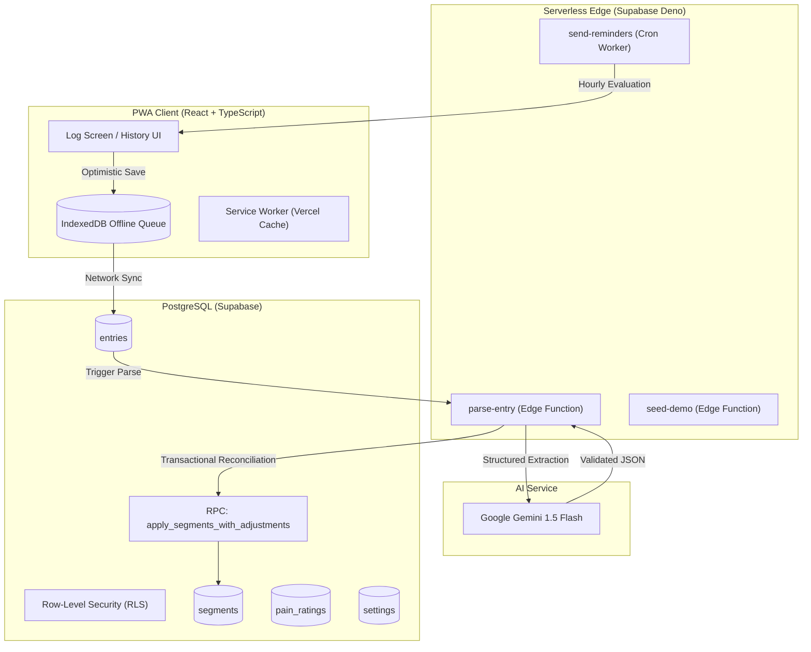

# Little Hours

An offline-first, AI-powered progressive web app (PWA) for logging daily life in natural language. Built with React, TypeScript, Supabase, Google Gemini, and a custom storybook design system.

[](https://www.typescriptlang.org/)
[](https://react.dev/)
[](https://vitejs.dev/)
[](https://supabase.com/)
[](https://ai.google.dev/)
[](https://web.dev/progressive-web-apps/)

---

## 🌟 Overview

Most time-tracking tools force users into rigid timers, dropdown menus, and tedious stopwatch workflows. **Little Hours** takes a radically different approach: **you write what you did in plain English, and an intelligent backend parses your day into structured, contiguous time segments.**

> *"went for a 30m morning walk with Sam, ate oatmeal, then worked on client design revisions until noon"*  
> ➔ Automatically parsed into **Exercise**, **Meals**, and **Work**, tagged with company (**Sam**), and chronologically slotted with zero timer anxiety.

---

## 🚀 Interactive Live Demo

Experience Little Hours instantly in your browser without creating an account:

👉 **[Try the Live Demo](https://littlehours-me5o3tub0-jackieackieackie.vercel.app/)** *(Click "Try the demo" on the login screen)*

- **Instant Ephemeral Sandbox**: Seeds 7 full days of realistic sample data (entries, contiguous segments, hourly ratings) calculated relative to your local timezone.
- **Full Feature Access**: Test natural language logging, AI activity parsing, category management, vacation mode, and data exports.
- **Complete Privacy & Isolation**: Each visitor runs in an isolated anonymous sandbox protected by PostgreSQL Row-Level Security (RLS) and Cloudflare Turnstile bot defense. Demo sandboxes self-destruct after 7 days.

---

## 🛠️ Key Technical Highlights

### 1. Asynchronous Natural Language Processing (NLP) Pipeline
- **Non-Blocking Background Parsing**: When an entry is saved, the UI updates optimistically within 50ms. A background Supabase Edge Function (Deno runtime) coordinates with the Gemini API to extract structured activities, categories, and company tags.
- **Robust Schema Validation & Self-Correction**: Implements strict validator schemas ensuring segment start/end times fit within the entry window. If the LLM generates overlapping or invalid timestamps, the validator prompts an automated single-turn repair.
- **Conversational Clarification Engine**: When an input is ambiguous, the system transitions to a non-blocking `needs_clarification` state, enabling natural roundtrip follow-up questions without mutating the user's original raw text.
- **Transactional Segment Reconciliation**: Segments inserted into existing days automatically resolve adjacent boundary overlaps and swallowed intervals via a PostgreSQL atomic RPC transaction (`apply_segments_with_adjustments`).

### 2. Privacy-First Health Tracking & Zero-Knowledge Architecture
- **Hourly Pain Logging (1–5 Scale)**: Integrates discrete hourly pain ratings for chronic illness tracking, with anchor guides based on the universal clinical pain scale.
- **Strict Data Segregation**: In compliance with strict health data privacy principles, **pain ratings are never sent to external LLMs**. The AI parser prompt is strictly firewalled from accessing health metrics.
- **Analytical Joins in Client-Side TypeScript**: Analytical joins between pain ratings and preceding activity segments (computing 60m, 180m, and 24h rolling lookback windows) run entirely client-side before CSV/JSON export.

### 3. Offline-First Progressive Web App (PWA)
- **Installable iOS/Android Shell**: Standalone PWA configuration with apple-touch-icons, splash screen theme colors, and custom web manifest.
- **IndexedDB Sync Queue**: Powered by `idb-keyval`, entries written offline or in spotty connectivity are stored in a persistent local queue and automatically flushed when the connection is restored.
- **Web Push Notifications & Smart Snooze**: Standardized VAPID Web Push architecture. An automated `pg_cron` worker evaluates user quiet hours (e.g. 8 AM – 11 PM) and **intelligently suppresses reminders** if the user has already logged or rated within the last 30 minutes.

### 4. Enterprise-Grade Multi-Tenant Isolation
- **Row-Level Security (RLS)**: Enforced across all PostgreSQL tables (`entries`, `segments`, `settings`, `pain_ratings`). Every database operation validates `user_id = auth.uid()`.
- **Cryptographic Claim Auditing**: Privileged Edge Functions verify the `is_anonymous` JWT claim to enforce demo quotas (500-char input limits, 15 AI parses/day, isolated demo API keys) without risk of privilege escalation.
- **Automated Verification Suite**: A dedicated integration test suite (`scripts/test-demo.ts`) validates 11 isolation invariants against the live deployed infrastructure.

### 5. Bespoke Storybook Design System
- Custom CSS variable design token architecture (`--dusty-rose`, `--parchment`, `--mauve`, `--plum-ink`, `--gold`).
- Letterpress-sunk inputs, double-ruled ornamental frames, and responsive mobile-first layouts tailored for modern mobile viewports (390px base).
- Accessible, custom hand-drawn SVG illustrations (Swan, Deer, Hummingbird, Flower Sprig) and custom typography (Cormorant Garamond & Lora).

---

## 🏛️ Architecture & Data Flow



---

## 💻 Tech Stack

| Layer | Technology | Purpose |
|---|---|---|
| **Frontend** | React 18, TypeScript, Vite | Core PWA client and component architecture |
| **Styling** | Custom CSS3 Tokens, SVG Illustrations | Tailored whimsical storybook aesthetic; zero bulky UI dependencies |
| **Typography** | Cormorant Garamond, Lora | Elegant editorial serif headings and high-legibility body |
| **Persistence & Auth** | Supabase (PostgreSQL, Auth, RLS) | Relational storage, user authentication, and multi-tenant security |
| **Edge Compute** | Deno, Supabase Edge Functions | Serverless endpoints for AI parsing, push notifications, and sandboxes |
| **Artificial Intelligence** | Google Gemini 1.5 Flash | High-speed, structured activity and company entity extraction |
| **Bot Mitigation** | Cloudflare Turnstile | Non-intrusive CAPTCHA protecting anonymous demo creation |
| **Push Notifications** | Web Push API, VAPID, `pg_cron` | Scheduled quiet-hour-compliant reminders with check-in suppression |
| **Offline Storage** | `idb-keyval` (IndexedDB), Workbox | Local offline mutation queuing and asset precaching |
| **Deployment** | Vercel, Supabase Cloud | Edge hosting, global CDN, and automated CI/CD previews |

---

## 📊 Analytical Data Model

```
                    ┌─────────────────┐
                    │   auth.users    │
                    └────────┬────────┘
                             │ 1:N
        ┌────────────────────┼────────────────────┐
        │ 1:N                │ 1:1                │ 1:N
 ┌──────▼──────┐      ┌──────▼──────┐      ┌──────▼──────┐
 │   entries   │      │  settings   │      │pain_ratings │
 └──────┬──────┘      └─────────────┘      └─────────────┘
        │ 1:N
 ┌──────▼──────┐
 │  segments   │
 └─────────────┘
```

- **`entries`**: Immutable records of the user's raw text, time boundaries (`window_start`, `window_end`), vacation status, and parsing status (`pending`, `parsed`, `needs_clarification`, `failed`).
- **`segments`**: Parsed intervals (`start_time`, `end_time`) belonging to an entry, mapped to one of 17 standardized categories with activity labels, confirmation state, and company tagging.
- **`pain_ratings`**: Independent clinical pain observations (1–5) timestamped to the end of each rated hour, joined client-side with activities for trend analysis.
- **`settings`**: User timezone, category definitions with LLM parsing descriptions, vacation mode toggle, and push reminder quiet hours.

---

## 🧪 Testing & Verification

The project includes unit, parser, and security isolation suites:

```bash
# Run unit & logic verification suites
npm test

# Run all test suites (categories, company extraction, vacation override)
npx tsx test/milestone-3-6.test.mjs
npx tsx test/milestone-3-7.test.mjs

# Run live demo sandbox security isolation suite
npx tsx scripts/test-demo.ts
```

### Verified Test Assertions
- ✅ **API Key Privacy**: Automated regex scan across all source and bundle assets ensuring 0 exposed secrets or private tokens.
- ✅ **Parser Prompt Constraints**: 13 unit test cases verifying prompt tie-breaks, prompt-injection defense, and vacation overrides.
- ✅ **Lookback Analytics Join**: Verified mathematical accuracy for 60m, 180m, and 1440m rolling category lookback calculations.
- ✅ **Multi-Tenant Invariants**: Automated tests verifying anonymous sandboxes cannot read or write foreign user data, access push subscriptions, or exceed daily rate limits.

---

## 🏃 Local Development

### 1. Clone & Install
```bash
git clone https://github.com/javassar/littlehours.git
cd littlehours
npm install
```

### 2. Environment Configuration
Create a `.env.local` file in the project root:
```env
VITE_SUPABASE_URL=https://your-project.supabase.co
VITE_SUPABASE_ANON_KEY=your-supabase-anon-key
VITE_TURNSTILE_SITE_KEY=your-cloudflare-turnstile-site-key
VITE_VAPID_PUBLIC_KEY=your-vapid-public-key
```

### 3. Run Development Server
```bash
npm run dev
```
Open [http://localhost:5173](http://localhost:5173) in your browser.

---

## 📄 License

This project is licensed under the MIT License - see the [LICENSE](LICENSE) file for details.
