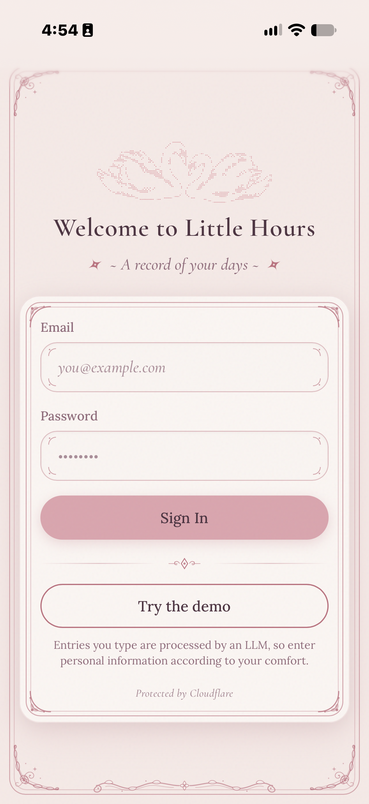
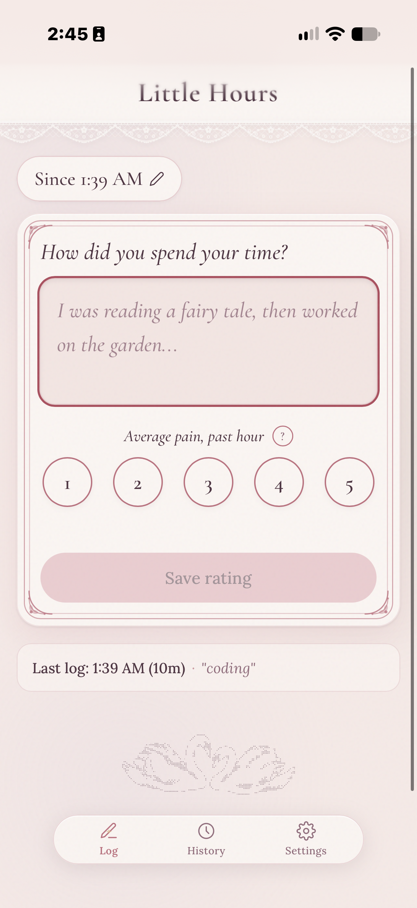
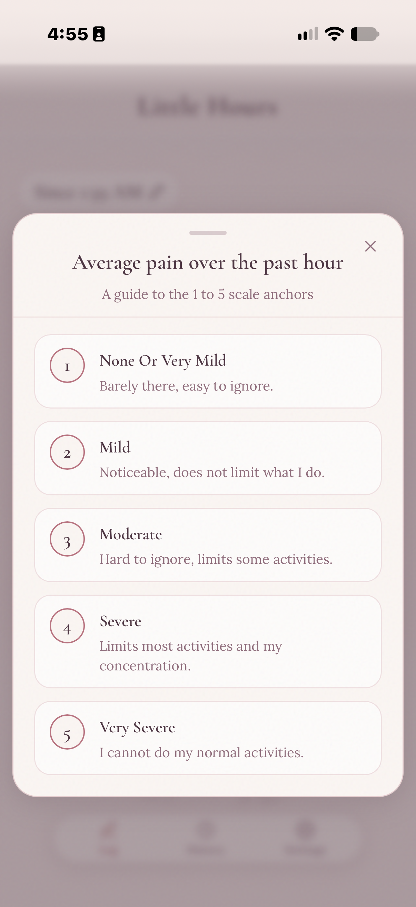
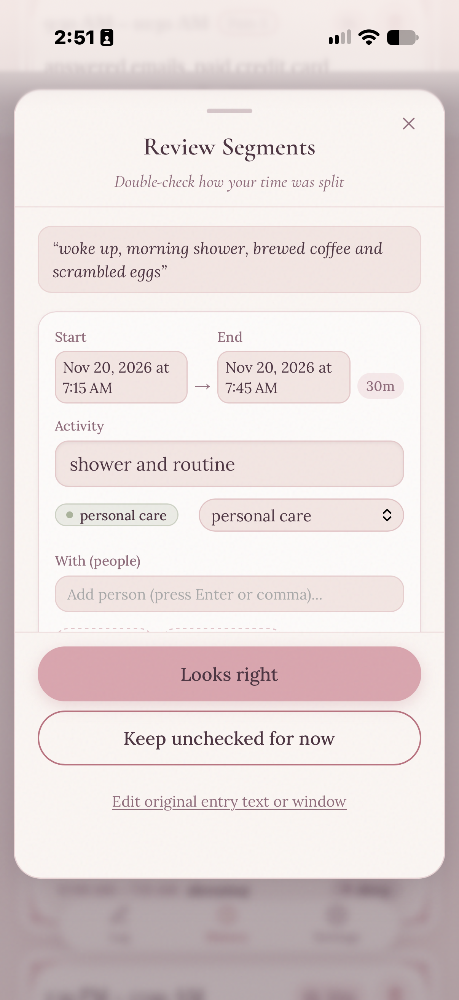
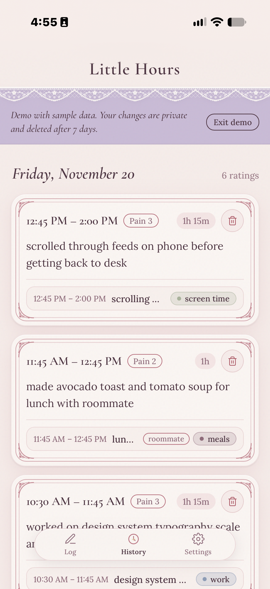
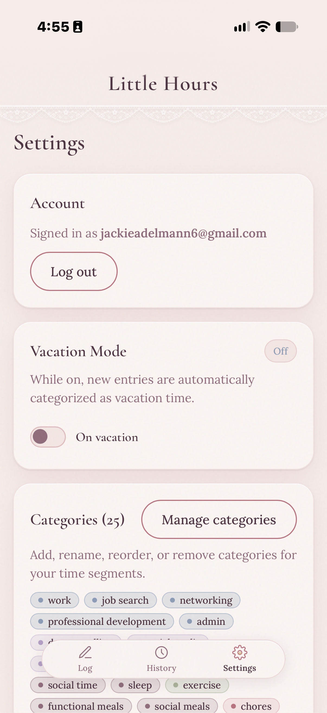

# Little Hours

Little Hours is an offline-first progressive web app for logging daily activities in natural language. Instead of starting stopwatches or picking categories from dropdown menus, you write a sentence about what you did, and the application parses it into structured, contiguous time segments.

[Live Demo](https://littlehours-me5o3tub0-jackieackieackie.vercel.app/) *(click "Try the demo" on the login screen to enter a temporary sandbox)*

---

## Screenshots

<!-- Add your screenshots to docs/screenshots/ and update the paths below -->

| Login Screen | Log Screen | Pain Rating Guide
| :---: | :---: | :---: |
|  | | 

| Segment Confirmation | History & Segments (Demo Mode) | Settings  
| :---: | :---: | :---: |
|  |  |  |

---

## How It Works

1. **Natural language entry**: You enter a rough time window and write what you did (for example, *"walked with Sam for 30 minutes, made breakfast, then worked on client revisions until noon"*).
2. **Background parsing**: An asynchronous Supabase Edge Function sends the entry to Google Gemini 1.5 Flash with a structured system prompt, extracting discrete activities, categories, and people mentioned.
3. **Validation and reconciliation**: The backend verifies that the returned segments are contiguous, fit within the entry window, and map to valid categories. Overlaps with existing timeline entries are reconciled transactionally in PostgreSQL via a custom RPC (`apply_segments_with_adjustments`).
4. **Clarification**: If an entry is too ambiguous to parse accurately, the system flags it as `needs_clarification`, prompting for details without altering the user's original raw text.

---

## Architecture & Engineering

### Natural Language Pipeline & Schema Validation
- **Asynchronous processing**: The UI saves entries optimistically and listens for status changes, keeping the interface responsive while the LLM runs in the background.
- **Single-turn repair**: If the model returns malformed JSON or invalid segment boundaries, an automated repair turn runs before the entry is marked as failed.
- **Clarification loop**: Ambiguous entries receive targeted follow-up questions stored alongside the entry, preserving the raw text as an immutable record.

### Offline Storage & Sync
- **IndexedDB mutation queue**: Local changes are stored using `idb-keyval` when offline. When connectivity is restored, the queue flushes pending writes to Supabase.
- **Service worker caching**: Static assets, fonts, and the app shell are precached with Workbox, allowing the app to open without a network connection.

### Privacy Boundary for Health Data
- **Zero-knowledge health logging**: The app supports hourly pain logging (1–5 scale) for chronic illness tracking. To maintain strict privacy, **pain ratings are never sent to Gemini or any external API**.
- **Client-side analytical joins**: The correlation between pain ratings and preceding activities (computing rolling 60-minute, 180-minute, and 24-hour category breakdowns) is calculated entirely in client-side TypeScript before CSV or JSON export.

### Push Reminders with Activity Suppression
- **Web Push (VAPID)**: Scheduled reminders run through a Supabase Edge Function triggered by `pg_cron`.
- **Intelligent suppression**: The worker checks recent activity and skips reminders if the user has logged an entry or submitted a pain rating within the last 30 minutes.

### Ephemeral Demo Sandboxes
- **Visitor isolation**: Portfolio visitors can test the full application without creating an account. The demo provisions a temporary anonymous Supabase user pre-seeded with 7 days of realistic time data matching the visitor's local timezone.
- **Security controls**: Anonymous users are governed by PostgreSQL Row-Level Security (RLS), protected by Cloudflare Turnstile, restricted from accessing push subscriptions, and capped to daily AI rate limits. Sandboxes are purged automatically after 7 days via a scheduled database cleanup job.

---

## Tech Stack

- **Frontend**: React 18, TypeScript, Vite
- **Styling**: Custom CSS tokens, Cormorant Garamond & Lora typography, custom SVG line illustrations
- **Backend & Database**: Supabase (PostgreSQL, Row-Level Security, Edge Functions in Deno)
- **AI Parsing**: Google Gemini 1.5 Flash
- **Bot Defense**: Cloudflare Turnstile
- **Notifications**: Web Push API, VAPID, `pg_cron`
- **Offline Sync**: IndexedDB (`idb-keyval`), Service Worker

---

## Data Model

- **`entries`**: Immutable records of user text, time boundaries (`window_start`, `window_end`), vacation flags, and parse status (`pending`, `parsed`, `needs_clarification`, `failed`).
- **`segments`**: Parsed time slices linked to an entry, containing activity labels, categories, confirmed states, and `company` tags (`text[]`).
- **`pain_ratings`**: Health observations (1–5) timestamped to the end of each rated hour, joined client-side for trend analysis.
- **`settings`**: Timezone, category definitions (names and LLM descriptions), push notification hours, and snooze states.

Every table enforces PostgreSQL Row-Level Security (`user_id = auth.uid()`).

---

## Testing

```bash
# Run unit and export logic tests
npm test

# Run parser prompt validation and company extraction suites
npx tsx test/milestone-3-6.test.mjs
npx tsx test/milestone-3-7.test.mjs

# Run demo sandbox isolation tests
npx tsx scripts/test-demo.ts
```

---

## Development Setup

```bash
git clone https://github.com/javassar/littlehours.git
cd littlehours
npm install
npm run dev
```

Create a `.env.local` file with:
```env
VITE_SUPABASE_URL=https://your-project.supabase.co
VITE_SUPABASE_ANON_KEY=your-anon-key
VITE_TURNSTILE_SITE_KEY=your-turnstile-site-key
VITE_VAPID_PUBLIC_KEY=your-vapid-public-key
```

---

## License

MIT
